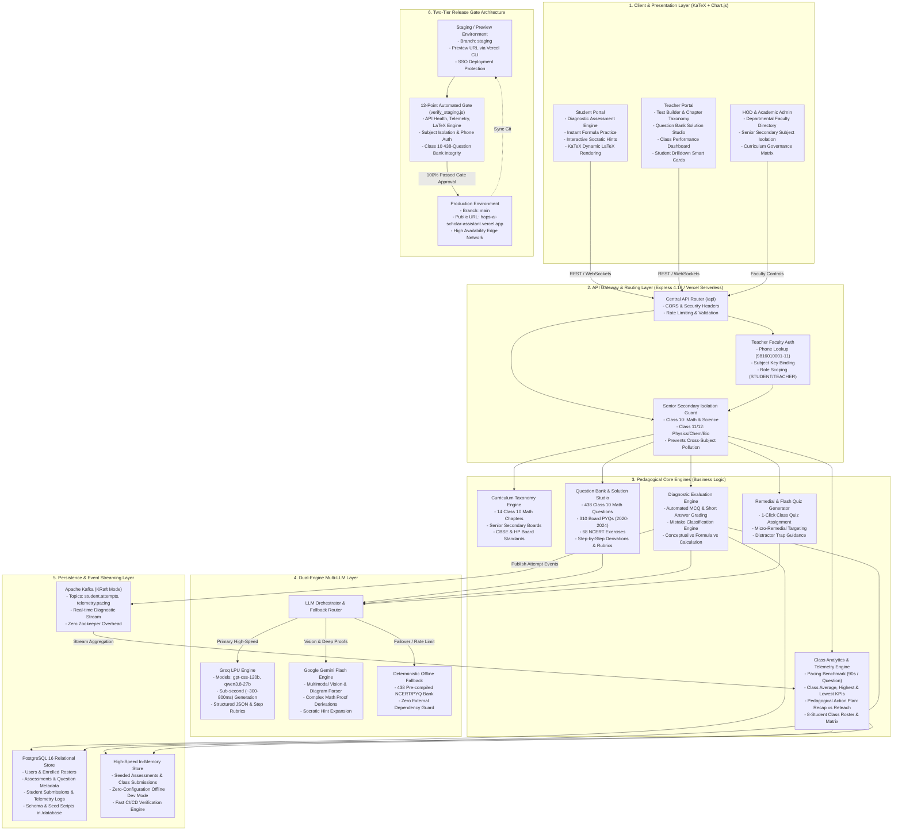
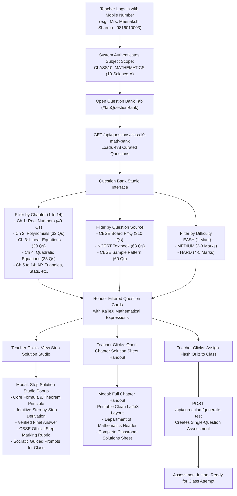
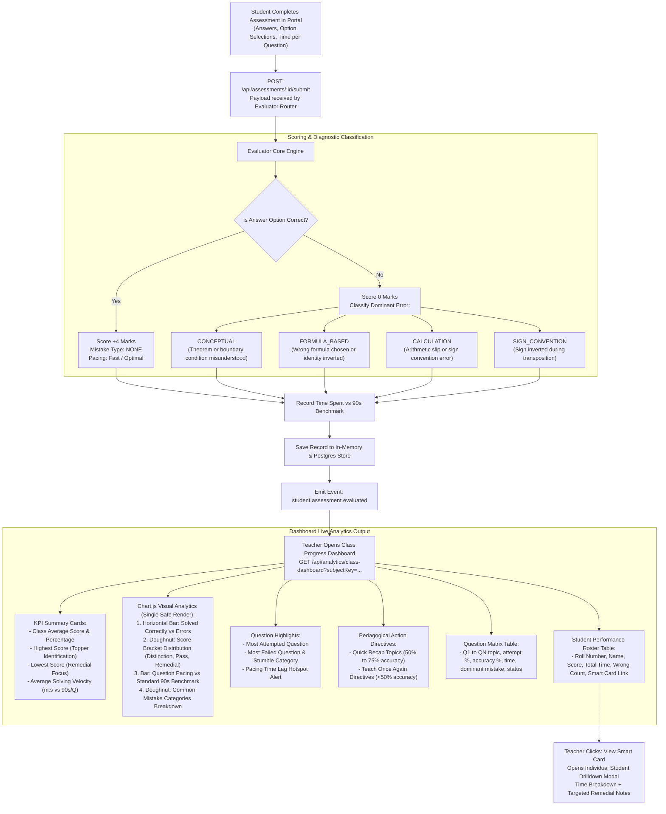
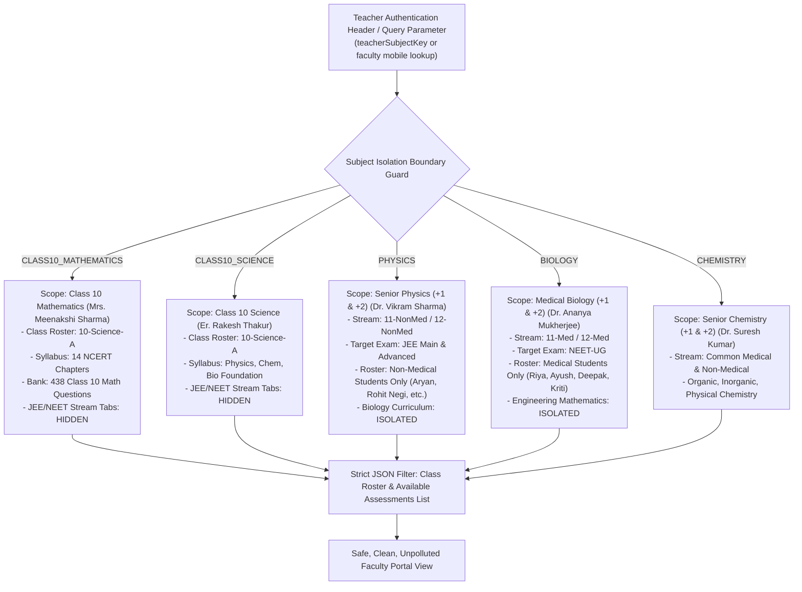

# HAPS-AI Scholar Assistant - Complete Architecture Diagrams for Excalidraw

This document contains production-grade Mermaid diagram code tailored for direct import into **Excalidraw** (`Insert` -> `Mermaid` or paste).

It covers the complete system architecture, data flow, pedagogical engines, multi-LLM orchestration, and release deployment pipeline for project handover.

---

## How to Import into Excalidraw

1. Open [Excalidraw](https://excalidraw.com).
2. Click the three horizontal dots `...` (More Tools) in the toolbar.
3. Select **Mermaid to Excalidraw** (or press the Mermaid shortcut).
4. Copy and paste any of the diagram blocks below into the text box and click **Insert**.

---

## Diagram 1: Master End-to-End System Architecture

This master diagram details the six horizontal architectural tiers: Frontend Presentation, API Gateway, Pedagogical Intelligence Core, Dual-Engine LLM Services, Data & Streaming Persistence, and Release Gates.

---

## Diagram 2: Teacher Question Bank & Step Solution Studio Lifecycle

This diagram demonstrates how a faculty member interacts with chapter filters, selects CBSE PYQs or NCERT questions, and generates intuitive step-by-step solutions or assigns flash quizzes.

---

## Diagram 3: Assessment Evaluation & Class Progress Dashboard Engine

This diagram outlines how student submissions are collected, evaluated against pacing benchmarks and error taxonomies, and rendered live on the Class Progress Dashboard.

---

## Diagram 4: Two-Tier Staging-to-Production Release Gate Pipeline

This diagram explains the safety gate mechanism ensuring that code is never pushed directly to production without passing local diagnostic suites and the 13 automated staging verification checks.

```mermaid
flowchart TD
    Developer["Developer / Agent Introduces Feature or Bugfix"] --> CommitStaging["Commit & Push to 'staging' Branch"]
    
    CommitStaging --> RunPipeline["Execute: ./scripts/promote_to_production.sh"]
    
    subgraph Stage1 ["Stage 1: Local Pre-Flight Diagnostic Suite"]
        RunPipeline --> Test1["test_evaluator.js (Core Evaluator & Scoring)"]
        Test1 --> Test2["test_subject_remedial_pipeline.js (Remedial Actions)"]
        Test2 --> Test3["test_teacher_auth_and_class_management.js (Faculty Auth)"]
        Test3 --> Test4["test_class10_sync_and_banks.js (Class 10 14 Chapters)"]
        Test4 --> Test5["test_question_bank_solution_studio.js (Solution Studio)"]
        Test5 --> Test6["test_class_progress_dashboard.js (45 Analytics Tests)"]
    end

    Test6 --> LocalCheck{"All Local Tests Passed?"}
    LocalCheck -->|No| BlockLocal["ABORT: Local Diagnostic Failed\nWorking tree preserved for debugging"]
    LocalCheck -->|Yes| DeployStaging["Stage 2: Deploy to Vercel Staging Environment\n(npx vercel deploy --yes)"]

    DeployStaging --> PreviewUrl["Generate Staging Preview URL\n(e.g., haps-ai-scholar-assistant-qcwwl1vne.vercel.app)"]

    subgraph Stage3 ["Stage 3: Automated Staging Verification Suite (13 Checks)"]
        PreviewUrl --> Warmup["Warming Up Preview Serverless Functions"]
        Warmup --> Check1["1. API Health Gateway (/api/health)"]
        Check1 --> Check2["2. Assessments Catalog (/api/assessments)"]
        Check2 --> Check3["3. Question Retrieval with LaTeX Formulas"]
        Check3 --> Check4["4. Class Telemetry & Pedagogical Action Plan"]
        Check4 --> Check5["5. Exam Pattern Blueprint Intelligence"]
        Check5 --> Check6["6. Live Test Submission Flow"]
        Check6 --> Check7["7. Remedial Formula Verification API"]
        Check7 --> Check8["8. Frontend App Shell & Modals (/index.html)"]
        Check8 --> Check9["9. Teacher Faculty Directory (/api/curriculum/faculty)"]
        Check9 --> Check10["10. Strict Subject Isolation Guard"]
        Check10 --> Check11["11. Teacher Mobile & Expertise Auth"]
        Check11 --> Check12["12. Biology Isolated Medical Students"]
        Check12 --> Check13["13. Class 10 Math 14-Chapter 438-Bank Integrity"]
    end

    Check13 --> StagingCheck{"100% of 13 Checks Passed?"}
    StagingCheck -->|No| BlockProd["STAGING GATE BLOCKED!\nExit with code > 0\nProduction strictly UNTOUCHED"]
    StagingCheck -->|Yes| Stage4["Stage 4: Promote and Deploy to Vercel Production\n(npx vercel deploy --prod --yes)"]

    Stage4 --> AliasProd["Alias to Live URL: haps-ai-scholar-assistant.vercel.app"]
    AliasProd --> MergeGit["Fast-Forward Merge 'staging' into 'main'\nPush updated 'main' to GitHub Origin"]
    MergeGit --> HealthPing["Final Production Health Validation Ping"]
    HealthPing --> SuccessHandover["PRODUCTION RELEASE COMPLETE & VERIFIED"]
```

---

## Diagram 5: Senior Secondary Subject Isolation Data Boundary

This diagram illustrates how data boundaries and teacher scopes are strictly isolated between Class 10 Foundation and Class 11/12 Senior Secondary Medical and Non-Medical streams.

---

## Summary of Key File Locations for Handover

| Architectural Component | File Path | Key Responsibilities |
| :--- | :--- | :--- |
| **Frontend Controller** | [frontend/js/app.js](file:///Users/ajaymokta2002/.gemini/antigravity-ide/scratch/haps-ai-scholar-assistant/frontend/js/app.js) | UI state, KaTeX rendering, Solution Studio modal, Chart.js analytics |
| **Frontend Structure** | [frontend/index.html](file:///Users/ajaymokta2002/.gemini/antigravity-ide/scratch/haps-ai-scholar-assistant/frontend/index.html) | Modern glassmorphic DOM layout, KPI cards, tables, modal containers |
| **Database & In-Memory Store** | [backend/src/config/database.js](file:///Users/ajaymokta2002/.gemini/antigravity-ide/scratch/haps-ai-scholar-assistant/backend/src/config/database.js) | Dual PostgreSQL/in-memory store, seeded rosters, Class 10 math assessments |
| **Class Analytics API** | [backend/src/routes/analytics.js](file:///Users/ajaymokta2002/.gemini/antigravity-ide/scratch/haps-ai-scholar-assistant/backend/src/routes/analytics.js) | Velocity calculations, error taxonomies, recap vs reteach action plans |
| **Curriculum & Test Builder API**| [backend/src/routes/curriculum.js](file:///Users/ajaymokta2002/.gemini/antigravity-ide/scratch/haps-ai-scholar-assistant/backend/src/routes/curriculum.js) | Faculty lookup, class rosters, test generation, attempt simulation |
| **Class 10 Math Bank (438 Qs)** | [backend/src/services/class10MathQuestionBank.js](file:///Users/ajaymokta2002/.gemini/antigravity-ide/scratch/haps-ai-scholar-assistant/backend/src/services/class10MathQuestionBank.js) | 14 chapters, 310 PYQs, 68 NCERT exercises, step rubrics |
| **Automated Verification Suite** | [scripts/verify_staging.js](file:///Users/ajaymokta2002/.gemini/antigravity-ide/scratch/haps-ai-scholar-assistant/scripts/verify_staging.js) | 13-point staging gate automated test runner |
| **Promotion Shell Pipeline** | [scripts/promote_to_production.sh](file:///Users/ajaymokta2002/.gemini/antigravity-ide/scratch/haps-ai-scholar-assistant/scripts/promote_to_production.sh) | Zero-downtime staging-to-production promotion and git sync pipeline |
